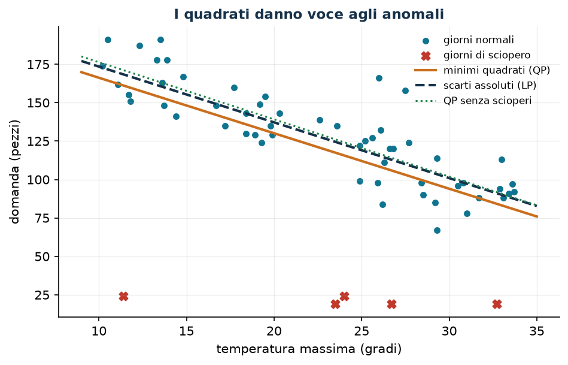
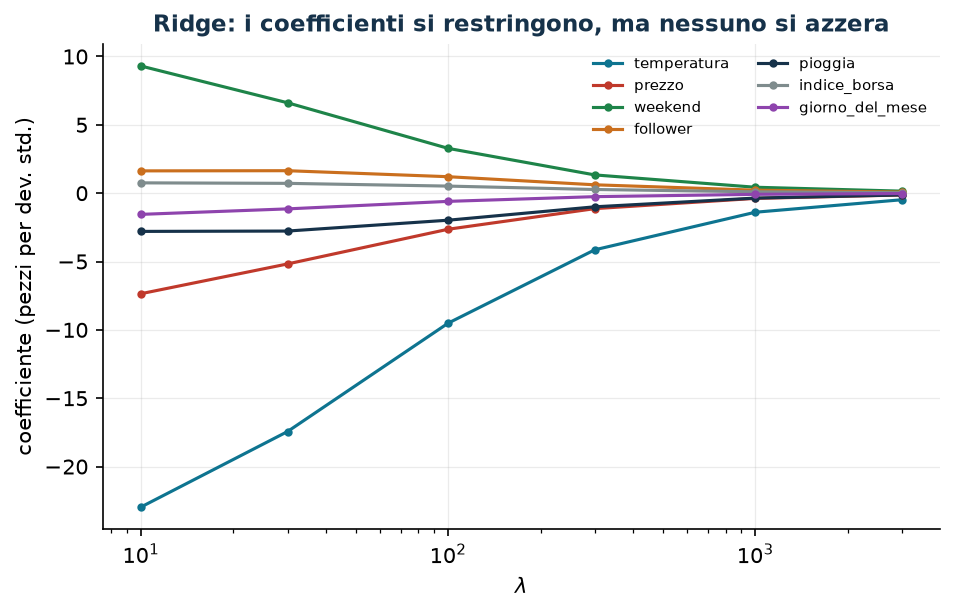

# Regressione ai minimi quadrati

[:material-file-pdf-box: Dispensa (PDF)](pdf/dispensa-modellazione-pnl.pdf) · [:material-presentation: Slide del capitolo (PDF)](pdf/slide-13-minimi-quadrati.pdf) · [:material-pencil: Esercizi](#esercizi) · [:material-gesture-tap: App: Minimi quadrati contro scarti assoluti](laboratorio/minimi-quadrati-lp.md)

**Classe:** QP convesso · **Script:** `python/lab13_minimi_quadrati.py`

[](https://colab.research.google.com/github/fabiofurini/modellazione-pnl/blob/main/notebooks/lab13_minimi_quadrati.ipynb)

Il caso, i dati e il modello lineare sono quelli di
[Modellazione PL, «Regressione robusta e quantile»](https://fabiofurini.github.io/modellazione-pl/regressione/):
sessanta giorni di vendite di una panetteria, cinque dei quali durante due scioperi.
Là si minimizza la somma degli scarti **assoluti** (un LP); qui la somma degli scarti
**al quadrato**: i minimi quadrati, un QP convesso.

## Modello

**Che cosa cambia.** I dati sono quelli del modello lineare ($n$ osservazioni, $p$
caratteristiche, valori $x_{ij}$, osservazioni $y_i$); il quantile $\tau$ non serve.
Introduciamo $p + 1$ variabili libere $w_j$ e $b$ e un residuo libero per ogni
osservazione, $r_i$. Il modello QP dei minimi quadrati è il seguente:

$$
\begin{aligned}
\min ~~ \sum_{i=1}^{n} r_i^{2} & & \\
\text{soggetto a} \quad \sum_{j=1}^{p} w_j\, x_{ij} + b + r_i &= y_i, & \forall i \in \{1, 2, \dots, n\}, \\
w_j &\gtreqless 0, & \forall j \in \{1, 2, \dots, p\}, \\
b &\gtreqless 0, & \\
r_i &\gtreqless 0, & \forall i \in \{1, 2, \dots, n\}.
\end{aligned}
$$

Descrizione della funzione obiettivo e dei vincoli:

- la funzione obiettivo quadratica somma i quadrati dei residui;
- i vincoli lineari definiscono il residuo di ogni osservazione ($n$ vincoli lineari);
- le variabili sono tutte libere: il quadrato non distingue il segno, e non servono
  le due parti positive del modello lineare.

!!! example "Esempio a mano (senza caratteristiche: torna la media)"
    Sette vendite: 88, 96, 104, 112, 120, 132, 148. Il solver dà
    $\tilde b = 800/7 = 114{,}2857$, $\tilde z = 2619{,}4286$ e moltiplicatori
    $\tilde\pi_i = 2\tilde r_i$. La stazionarietà rispetto a $b$ dà $\sum_i r_i = 0$:
    la stima è la **media**. Sugli stessi numeri la regressione robusta dà la mediana
    112 e quella quantile ($\tau = 9/13$) dà 120. Se l'ultimo valore passa a 248, la
    media sale di 14,29; la mediana resta 112.

!!! note "Le KKT sono le equazioni normali"
    $\pi_i = 2 r_i$, $\sum_i r_i = 0$, $\sum_i r_i\, x_{ij} = 0$ per ogni $j$: residui
    a somma nulla e ortogonali a ogni caratteristica. Il moltiplicatore è il doppio del
    residuo: un dato lontano pesa quanto è lontano.

## Caso di studio

```text
QP (minimi quadrati)  : domanda = 202,34 - 3,61 * temperatura
LP (scarti assoluti)  : domanda = 209,77 - 3,63 * temperatura
QP senza gli scioperi : domanda = 213,58 - 3,72 * temperatura
Scarto assoluto medio sui 55 giorni normali: QP 14,81  LP 13,08  QP pulito 13,05
Quota della somma dei quadrati dovuta ai 5 giorni di sciopero: 71,4%
```



Cinque giorni su sessanta producono il 71% della somma dei quadrati: i minimi quadrati
vanno accompagnati da un controllo degli anomali, la regressione robusta no.

**Previsione per il newsvendor** (55 giorni normali, tre caratteristiche):

```text
Giorno tipo (28 gradi, prezzo 3,00, weekend):
  media prevista (QP)                  128,7 pezzi
  media + z*sigma, z = 0,5024          133,5 pezzi
  quantile 9/13 previsto (LP)          132,1 pezzi
```

La media più $z\sigma$ suppone residui normali; la regressione quantile stima il
quantile senza ipotesi sulla forma degli errori.

## Sensitività

```text
spostamento     QP: b      w         LP: b      w
      0       213,58  -3,723        210,49  -3,578
    -50       217,09  -3,918        211,63  -3,689
   -100       220,59  -4,113        211,63  -3,689
   -200       227,60  -4,503        211,63  -3,689
```

Spostando la domanda del giorno normale più caldo, la stima QP si muove in
proporzione all'errore; quella LP cambia una volta e poi si ferma.

**Regressione ridge.** Con $\lambda \sum_j w_j^2$ in obiettivo (ancora un QP convesso)
i coefficienti si restringono, ma nessuno si azzera; il budget sui valori assoluti di
Modellazione PL, invece, lascia fuori le caratteristiche inutili.



## Codice

Lo script completo del capitolo è
[`python/lab13_minimi_quadrati.py`](https://github.com/fabiofurini/modellazione-pnl/blob/main/python/lab13_minimi_quadrati.py)
(riproducibile con `python3 lab13_minimi_quadrati.py` dalla cartella `python/`); lo
stesso codice è nel notebook che si apre in Colab dal badge in cima alla pagina.

??? example "Mostra lo script completo — `lab13_minimi_quadrati.py`"

    ```python
    """Capitolo 13 — Regressione ai minimi quadrati (QP convesso).

    Caso di studio: lo stesso della regressione robusta e quantile (Modellazione PL):
    sessanta giorni di vendite di una panetteria (domanda, temperatura, prezzo,
    weekend), cinque dei quali durante due scioperi dei trasporti.

    Contenuto:
      1. Senza caratteristiche il QP restituisce la media (esempio a mano)
      2. Dati (gli stessi del caso lineare)
      3. Minimi quadrati (QP) contro scarti assoluti (LP): robustezza agli anomali
      4. Lettura delle KKT: residui, moltiplicatori e equazioni normali
      5. Previsione per il newsvendor: media più scorta contro regressione quantile
      6. Sensitività: un solo giorno anomalo e la regressione ridge
    """
    import gurobipy as gp
    import numpy as np
    import pandas as pd
    from gurobipy import GRB
    from statistics import NormalDist

    from stile import (ARANCIO, BLU, GRIGIO, ROSSO, TEAL, VERDE, intestazione, plt,
                       salva_dat, salva_dati, salva_figura)

    TAU_NV = 9 / 13                                # frattile critico della panetteria


    # ----------------------------------------------------------------------
    # MODELLI: minimi quadrati (QP) e, per confronto, regressione quantile (LP)
    # ----------------------------------------------------------------------
    def minimi_quadrati(X, y, lam=0.0):
        """min sum_i r_i^2 + lam * sum_j w_j^2  con  X w + b + r = y  (QP convesso)."""
        n, p = X.shape
        m = gp.Model("minimi_quadrati")
        m.Params.OutputFlag = 0
        w = m.addVars(p, lb=-GRB.INFINITY, name="w")
        b = m.addVar(lb=-GRB.INFINITY, name="b")
        r = m.addVars(n, lb=-GRB.INFINITY, name="r")
        residuo = m.addConstrs(
            (gp.quicksum(X[i, j] * w[j] for j in range(p)) + b + r[i] == y[i] for i in range(n)),
            name="residuo")
        m.setObjective(gp.quicksum(r[i] * r[i] for i in range(n))
                       + lam * gp.quicksum(w[j] * w[j] for j in range(p)), GRB.MINIMIZE)
        m.optimize()
        assert m.Status == GRB.OPTIMAL
        return (m, np.array([w[j].X for j in range(p)]), b.X,
                np.array([r[i].X for i in range(n)]), np.array([residuo[i].Pi for i in range(n)]))


    def regressione_quantile(X, y, tau=0.5):
        """min sum_i [tau u_i + (1-tau) v_i]  con  X w + b + u - v = y  (LP)."""
        n, p = X.shape
        m = gp.Model("quantile")
        m.Params.OutputFlag = 0
        w = m.addVars(p, lb=-GRB.INFINITY, name="w")
        b = m.addVar(lb=-GRB.INFINITY, name="b")
        u = m.addVars(n, name="u")
        v = m.addVars(n, name="v")
        m.addConstrs((gp.quicksum(X[i, j] * w[j] for j in range(p)) + b + u[i] - v[i] == y[i]
                      for i in range(n)), name="residuo")
        m.setObjective(gp.quicksum(tau * u[i] + (1 - tau) * v[i] for i in range(n)), GRB.MINIMIZE)
        m.optimize()
        assert m.Status == GRB.OPTIMAL
        return np.array([w[j].X for j in range(p)]), b.X


    def scarto_medio(X, y, coef, b):
        return float(np.abs(y - (X @ coef + b)).mean())


    # ----------------------------------------------------------------------
    # 1. SENZA CARATTERISTICHE: IL QP RESTITUISCE LA MEDIA
    # ----------------------------------------------------------------------
    intestazione("Senza caratteristiche: la media (esempio svolto a mano)")
    y7 = np.array([88.0, 96.0, 104.0, 112.0, 120.0, 132.0, 148.0])
    m0, _, b0, r0, pi0 = minimi_quadrati(np.zeros((7, 0)), y7)
    print(f"Sette giorni: {y7.astype(int)}")
    print(f"Intercetta ottima b = {b0:.4f}  (media = {y7.mean():.4f} = 800/7)")
    print(f"Valore ottimo = {m0.ObjVal:.4f}")
    print(f"Residui r = {np.round(r0, 4)}  somma = {r0.sum():.6f}")
    print(f"Duali  pi = {np.round(pi0, 4)}  (= 2 r_i)  somma = {pi0.sum():.6f}")
    _, bq_med = regressione_quantile(np.zeros((7, 0)), y7, tau=0.5)
    _, bq_nv = regressione_quantile(np.zeros((7, 0)), y7, tau=TAU_NV)
    print(f"Confronto: mediana (LP, tau = 1/2) = {bq_med:.1f}; quantile 9/13 (LP) = {bq_nv:.1f}")
    y7b = y7.copy(); y7b[-1] = 248.0
    _, _, b0b, _, _ = minimi_quadrati(np.zeros((7, 0)), y7b)
    _, bqb = regressione_quantile(np.zeros((7, 0)), y7b, tau=0.5)
    print(f"Se l'ultimo valore passa da 148 a 248: media {b0b:.4f} (+{b0b - b0:.4f}), "
          f"mediana {bqb:.1f} (invariata)")

    # ----------------------------------------------------------------------
    # 2. DATI (gli stessi del caso lineare: stesso generatore, stesso seme)
    # ----------------------------------------------------------------------
    # I dati sono quelli del caso lineare in Modellazione PL: si scrivono qui (stesso seme),
    # così lo script gira anche in Colab; i file CSV stanno nel repository di Modellazione PL.
    intestazione("Storico della panetteria: 60 giorni")
    rng = np.random.default_rng(16)
    n = 60
    temperatura = np.round(rng.uniform(10, 34, n), 1)
    prezzo = rng.choice([2.20, 2.60, 3.00, 3.40], n)
    weekend = (rng.random(n) < 0.30).astype(float)
    domanda = (258 - 3.7 * temperatura - 19.0 * prezzo + 33.0 * weekend
               + rng.normal(0, 9, n))
    anomalo = np.zeros(n)
    giorni_sciopero = [11, 22, 29, 41, 46]         # due scioperi dei trasporti
    domanda[giorni_sciopero] = rng.uniform(18, 32, len(giorni_sciopero))
    anomalo[giorni_sciopero] = 1
    domanda = np.round(domanda).astype(float)
    follower = np.round(rng.uniform(8, 20, n), 1)
    pioggia = np.round(rng.uniform(0, 12, n), 1)
    borsa = np.round(rng.uniform(95, 115, n), 1)
    giorno_mese = rng.integers(1, 29, n).astype(float)

    print(f"Domanda: min {domanda.min():.0f}, media {domanda.mean():.1f}, "
          f"max {domanda.max():.0f}   giorni di sciopero: {[g + 1 for g in giorni_sciopero]}")

    # ----------------------------------------------------------------------
    # 3. MINIMI QUADRATI (QP) CONTRO SCARTI ASSOLUTI (LP)
    # ----------------------------------------------------------------------
    intestazione("Minimi quadrati (QP) contro scarti assoluti (LP)")
    Xt = temperatura.reshape(-1, 1)
    buoni = anomalo == 0
    m_ls, w_ls, b_ls, r_ls, pi_ls = minimi_quadrati(Xt, domanda)
    w_lad, b_lad = regressione_quantile(Xt, domanda, tau=0.5)
    _, w_pul, b_pul, _, _ = minimi_quadrati(Xt[buoni], domanda[buoni])
    print(f"QP  (minimi quadrati): domanda = {b_ls:.2f} {w_ls[0]:+.2f} * temperatura")
    print(f"LP  (scarti assoluti): domanda = {b_lad:.2f} {w_lad[0]:+.2f} * temperatura")
    print(f"QP senza i 5 giorni di sciopero: domanda = {b_pul:.2f} {w_pul[0]:+.2f} * temperatura")
    print(f"Somma dei quadrati: {m_ls.ObjVal:.1f}   radice dell'errore quadratico medio "
          f"{np.sqrt(m_ls.ObjVal / n):.2f} pezzi")
    print(f"Scarto assoluto medio sui 55 giorni normali: QP {scarto_medio(Xt[buoni], domanda[buoni], w_ls, b_ls):.2f}, "
          f"LP {scarto_medio(Xt[buoni], domanda[buoni], w_lad, b_lad):.2f}, "
          f"QP pulito {scarto_medio(Xt[buoni], domanda[buoni], w_pul, b_pul):.2f} pezzi")
    quota = (r_ls[~buoni] ** 2).sum() / m_ls.ObjVal
    print(f"Quota della somma dei quadrati dovuta ai 5 giorni di sciopero: {100 * quota:.1f}%")

    # ----------------------------------------------------------------------
    # 4. LETTURA DELLE KKT: RESIDUI, MOLTIPLICATORI, EQUAZIONI NORMALI
    # ----------------------------------------------------------------------
    intestazione("KKT dei minimi quadrati")
    print(f"max |pi_i - 2 r_i| = {np.abs(pi_ls - 2 * r_ls).max():.2e}")
    print(f"somma dei residui           = {r_ls.sum():.6f}  (stazionarieta' rispetto a b)")
    print(f"somma residui * temperatura = {(r_ls * temperatura).sum():.6f}  (rispetto a w)")
    A = np.column_stack([np.ones(n), temperatura])
    coef_ne = np.linalg.solve(A.T @ A, A.T @ domanda)
    print(f"Equazioni normali (A'A) c = A'y: b = {coef_ne[0]:.2f}, w = {coef_ne[1]:+.2f}  "
          f"(uguali al QP)")
    print(f"Residui dei giorni di sciopero: {np.round(r_ls[~buoni], 1)}")
    print(f"Residuo massimo in valore assoluto fra i giorni normali: {np.abs(r_ls[buoni]).max():.1f}")

    # ----------------------------------------------------------------------
    # 5. PREVISIONE PER IL NEWSVENDOR: MEDIA + SCORTA CONTRO QUANTILE
    # ----------------------------------------------------------------------
    intestazione("Tre caratteristiche sui 55 giorni normali: media e quantile")
    X3 = np.column_stack([temperatura, prezzo, weekend])[buoni]
    y3 = domanda[buoni]
    _, w3, b3, r3, _ = minimi_quadrati(X3, y3)
    w3q, b3q = regressione_quantile(X3, y3, tau=TAU_NV)
    sigma = float(np.sqrt((r3 ** 2).sum() / (len(y3) - 4)))
    print(f"Minimi quadrati: domanda = {b3:.2f} {w3[0]:+.2f}*temp {w3[1]:+.2f}*prezzo "
          f"{w3[2]:+.2f}*weekend   (sigma dei residui {sigma:.2f})")
    print(f"Quantile 9/13  : domanda = {b3q:.2f} {w3q[0]:+.2f}*temp {w3q[1]:+.2f}*prezzo "
          f"{w3q[2]:+.2f}*weekend")
    giorno_tipo = np.array([28.0, 3.00, 1.0])
    media_prev = float(giorno_tipo @ w3 + b3)
    z = NormalDist().inv_cdf(TAU_NV)
    print(f"Giorno tipo (28 gradi, prezzo 3,00, weekend):")
    print(f"  media prevista (QP)               {media_prev:6.1f} pezzi")
    print(f"  media + z*sigma, z = {z:.4f}      {media_prev + z * sigma:6.1f} pezzi")
    print(f"  quantile 9/13 previsto (LP)       {float(giorno_tipo @ w3q + b3q):6.1f} pezzi")
    quota_sotto = float((y3 < X3 @ w3 + b3 + z * sigma - 1e-9).mean())
    print(f"  quota dei 55 giorni sotto media + z*sigma: {quota_sotto:.3f} (obiettivo {TAU_NV:.3f})")

    # ----------------------------------------------------------------------
    # 6. SENSITIVITÀ: UN GIORNO ANOMALO E LA REGRESSIONE RIDGE
    # ----------------------------------------------------------------------
    intestazione("Sensitività: un solo giorno anomalo")
    k = int(np.argmax(temperatura[buoni]))          # il giorno normale piu' caldo (leva alta)
    print(f"Giorno spostato: il piu' caldo fra i normali ({temperatura[buoni][k]:.1f} gradi, "
          f"domanda {domanda[buoni][k]:.0f})")
    righe = []
    for delta in (0, -50, -100, -150, -200):
        yy = domanda[buoni].copy()
        yy[k] += delta
        _, wq, bq, _, _ = minimi_quadrati(Xt[buoni], yy)
        wl, bl = regressione_quantile(Xt[buoni], yy, tau=0.5)
        righe.append((delta, bq, wq[0], bl, wl[0]))
        print(f"  domanda spostata di {delta:5d}: QP b = {bq:7.2f}, w = {wq[0]:+.3f}   "
              f"LP b = {bl:7.2f}, w = {wl[0]:+.3f}")
    salva_dati(pd.DataFrame(righe, columns=["spostamento", "b_qp", "w_qp", "b_lp", "w_lp"]),
               "minimi_quadrati_anomalo")

    intestazione("Regressione ridge: penalita' quadratica sui coefficienti")
    nomi = ["temperatura", "prezzo", "weekend", "follower", "pioggia", "indice_borsa", "giorno_del_mese"]
    Xg = np.column_stack([temperatura, prezzo, weekend, follower, pioggia, borsa, giorno_mese])[buoni]
    Xs = (Xg - Xg.mean(axis=0)) / Xg.std(axis=0)    # standardizzazione obbligatoria
    percorso = []
    for lam in (0, 10, 30, 100, 300, 1000, 3000):
        _, wr, br, rr, _ = minimi_quadrati(Xs, y3, lam=lam)
        rmse = float(np.sqrt((rr ** 2).mean()))
        percorso.append({"lambda": lam, "rmse": rmse, **{nm: wr[j] for j, nm in enumerate(nomi)}})
        nulli = int((np.abs(wr) < 1e-6).sum())
        print(f"  lambda = {lam:5d}: " + " ".join(f"{c:+7.2f}" for c in wr)
              + f"   rmse {rmse:6.2f}   coefficienti nulli {nulli}")
    percorso = pd.DataFrame(percorso)
    salva_dati(percorso, "minimi_quadrati_ridge")
    print("  (ordine: " + ", ".join(nomi) + ")")

    # ----------------------------------------------------------------------
    # 7. FIGURE
    # ----------------------------------------------------------------------
    salva_dat(pd.DataFrame({"temperatura": temperatura, "domanda": domanda,
                            "sciopero": anomalo.astype(int)}), "cap13_panetteria")
    salva_dat(percorso[percorso["lambda"] > 0].assign(loglam=np.log10(percorso["lambda"][1:])),
              "cap13_ridge")

    fig, ax = plt.subplots()
    ax.scatter(temperatura[buoni], domanda[buoni], s=18, color=TEAL, label="giorni normali")
    ax.scatter(temperatura[~buoni], domanda[~buoni], s=45, color=ROSSO, marker="X",
               label="giorni di sciopero")
    gr = np.linspace(9, 35, 2)
    ax.plot(gr, b_ls + w_ls[0] * gr, color=ARANCIO, lw=2, label="minimi quadrati (QP)")
    ax.plot(gr, b_lad + w_lad[0] * gr, color=BLU, lw=2, ls="--", label="scarti assoluti (LP)")
    ax.plot(gr, b_pul + w_pul[0] * gr, color=VERDE, lw=1.5, ls=":", label="QP senza scioperi")
    ax.set_xlabel("temperatura massima (gradi)"); ax.set_ylabel("domanda (pezzi)")
    ax.set_title("I quadrati danno voce agli anomali")
    ax.legend(loc="upper right", fontsize=8)
    salva_figura(fig, "cap13_minimi_quadrati")

    fig, ax = plt.subplots()
    p2 = percorso[percorso["lambda"] > 0]
    for j, nm in enumerate(nomi):
        ax.plot(p2["lambda"], p2[nm], "-o", ms=3, label=nm, color=[TEAL, ROSSO, VERDE, ARANCIO, BLU, GRIGIO, "#8E44AD"][j])
    ax.set_xscale("log")
    ax.set_xlabel("$\\lambda$"); ax.set_ylabel("coefficiente (pezzi per dev. std.)")
    ax.set_title("Ridge: i coefficienti si restringono, ma nessuno si azzera")
    ax.legend(fontsize=7, ncol=2)
    salva_figura(fig, "cap13_ridge")

    print("\nFatto: capitolo 13.")
    ```

## Esercizi

1. **A mano** — somma dei quadrati dei residui per $b = 112$ e per $b = 800/7$.
2. **Equazioni normali** — risolverle per la retta con la sola temperatura sui 55
   giorni normali e confrontarle con il QP.
3. **Pesi** — peso 0,01 sui giorni di sciopero, sui 60 giorni con la sola temperatura.
4. **Huber** — perdita quadratica fino a 20 e lineare oltre, scritta come QP.
5. **Validazione** — stima sui primi 40 giorni, verifica sui 20 restanti senza scioperi.
