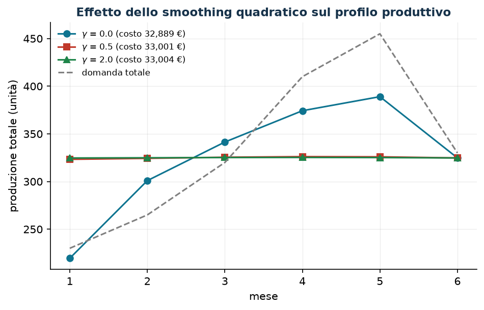
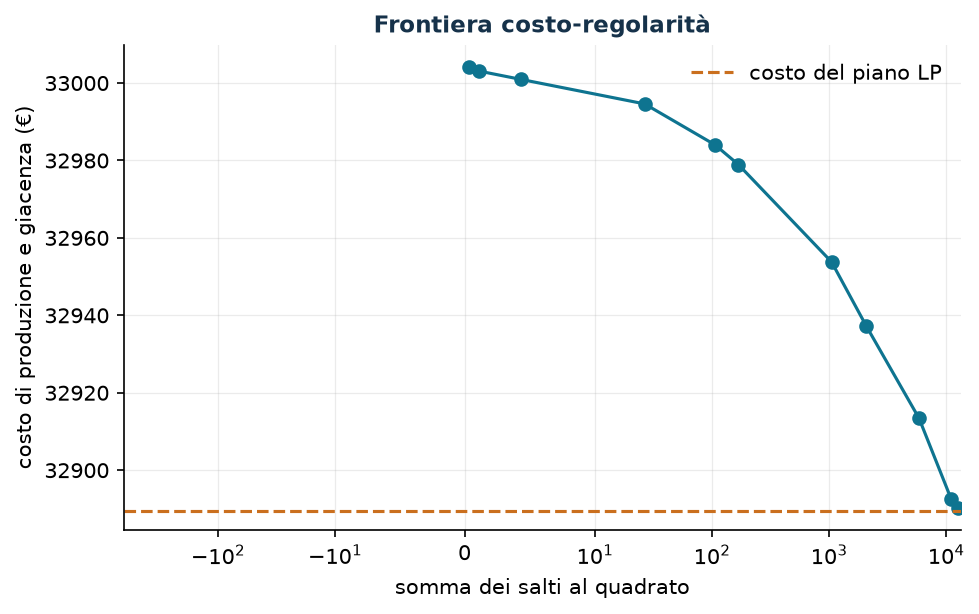

# Produzione con smoothing quadratico

[:material-file-pdf-box: Dispensa (PDF)](pdf/dispensa-modellazione-pnl.pdf) · [:material-presentation: Slide del capitolo (PDF)](pdf/slide-04-produzione-quadratica.pdf) · [:material-pencil: Esercizi](#esercizi)

**Classe:** QP convesso · **Script:** `python/lab04_produzione_quadratica.py`

[](https://colab.research.google.com/github/fabiofurini/modellazione-pnl/blob/main/notebooks/lab04_produzione_quadratica.ipynb)

!!! nota "Prerequisiti"

    - Dal modulo *Modellazione PL*, [Capitolo 5 «Produzione e scorte multiperiodali»](https://fabiofurini.github.io/modellazione-pl/produzione/): il modello lineare di produzione e scorte, con i suoi dati.

    - Da questo modulo, [Capitolo 2 «Richiami: convessità, programmazione quadratica e condizioni KKT»](https://fabiofurini.github.io/modellazione-pnl/teoria-non-lineare/): i programmi quadratici convessi, le condizioni KKT e i moltiplicatori come prezzi ombra.

    - Da questo modulo, [Capitolo 3 «Il solver per i modelli non lineari»](https://fabiofurini.github.io/modellazione-pnl/solver-non-lineare/): gli obiettivi quadratici e i moltiplicatori di un QP in `gurobipy`.

!!! chiave "Obiettivi"

    Alla fine di questo capitolo sarai in grado di:

    - aggiungere un termine quadratico convesso a un modello lineare;

    - leggere i moltiplicatori di un QP e verificarli per perturbazione;

    - tracciare la frontiera costo-regolarità al variare del peso.

Il caso, i dati e il modello lineare sono quelli di
[Modellazione PL, «Produzione e scorte»](https://fabiofurini.github.io/modellazione-pl/produzione/).
Il piano a costo minimo cambia ritmo bruscamente: la produzione totale passa da
219,5 a 389,0 unità, con salti fino a 81,4 unità in un mese. Qui si aggiunge
all'obiettivo una penalità **quadratica** sui salti della produzione totale: un salto
doppio costa quattro volte tanto.

## Modello

**Che cosa cambia.** Dati, variabili e vincoli sono quelli del modello lineare
($x_{it}$ produzione, $s_{it}$ scorta, domanda $d_{it}$, costi $c_{it}$ e $h_{it}$,
ore $a_i$, capacità $b_t$). Si aggiunge un solo dato:

| Simbolo | Tipo | Significato |
|---|---|---|
| $\gamma$ | $\in \mathbb{Q}_{\ge 0}$ | peso dei salti della produzione totale (€ per unità²) |

Usando le stesse variabili, un modello QP per il problema è il seguente:

$$
\begin{aligned}
\min ~~ \sum_{i=1}^{n} \sum_{t=1}^{m} \bigl( c_{it}\, x_{it} + h_{it}\, s_{it} \bigr) + \gamma \sum_{t=2}^{m} \Bigl( \sum_{i=1}^{n} x_{it} - \sum_{i=1}^{n} x_{i,t-1} \Bigr)^{2} & & \\
\text{soggetto a} \quad s_{i,t-1} + x_{it} &= d_{it} + s_{it}, & \forall i \in \{1, 2, \dots, n\},~\forall t \in \{1, 2, \dots, m\}, \\
\sum_{i=1}^{n} a_i\, x_{it} &\le b_t, & \forall t \in \{1, 2, \dots, m\}, \\
x_{it} &\ge 0, & \forall i \in \{1, 2, \dots, n\},~\forall t \in \{1, 2, \dots, m\}, \\
s_{it} &\ge 0, & \forall i \in \{1, 2, \dots, n\},~\forall t \in \{1, 2, \dots, m\}.
\end{aligned}
$$

Descrizione della funzione obiettivo e dei vincoli:

- la funzione obiettivo quadratica somma al costo di produzione e di giacenza il peso
  $\gamma$ per il quadrato di ogni salto della produzione totale;
- i vincoli lineari di **bilancio** delle scorte ($n\,m$ vincoli lineari);
- i vincoli lineari di **capacità** ($m$ vincoli lineari);
- i vincoli di non negatività definiscono le variabili del modello.

Il QP è **convesso**: ogni salto è lineare nelle variabili, il suo quadrato è
convesso e i vincoli sono lineari. Con $\gamma = 0$ si ritrova il modello lineare.

!!! example "Esempio a mano (1 prodotto, 2 mesi)"
    $d = (60, 100)$, $c = 10$, $h = 1$, capacità abbondante; il modello lineare
    produce su domanda, costo $1600$. Con $\gamma = 0{,}5$ il solver dà
    $\tilde x = (79{,}75;\ 80{,}25)$, $\tilde s_1 = 19{,}75$, $z(\text{NLP}) = 1619{,}875$ e
    moltiplicatori dei bilanci $(9{,}5;\ 10{,}5)$. Dai bilanci il salto è
    $40 - 2s_1$ e l'obiettivo $f(s_1) = 1600 + s_1 + \gamma(40 - 2s_1)^2$:
    $f'(s_1) = 0$ dà $s_1 = 20 - 1/(8\gamma)$. Per $\gamma \le 1/160$ conviene non
    tenere scorta. Con scorta positiva le KKT danno $\tilde\pi_2 - \tilde\pi_1 = h$.

## Risultati

```text
gamma = 0,0: obiettivo 32.889,33  costo lineare 32.889,33  salto max 81,4
   produzione totale:  219,5  301,0  341,4  374,3  389,0  324,8
gamma = 0,5: obiettivo 33.003,10  costo lineare 33.000,96  salto max  1,2
   produzione totale:  323,3  324,3  325,5  326,1  325,9  324,8
gamma = 2,0: obiettivo 33.004,74  costo lineare 33.004,14  salto max  0,4
```



Il piano regolare costa 111,63 € in più del piano lineare (+0,34%). A scorta va
soprattutto il prodotto 1, fino a 212,6 unità: la penalità conta le **unità**, non
le ore, e il prodotto 1 dà più unità per ora macchina ($a_1 = 0{,}9$). Nel modello
lineare la scorta anticipata era invece quella del prodotto 3.

## Sensitività

```text
mese 4: Pi(gamma=0) = -2,286   Pi(gamma=0,5) = -0,667 EUR/ora
mese 5: Pi(gamma=0) = -3,048   Pi(gamma=0,5) = -1,333 EUR/ora
mese 6: Pi(gamma=0) = -3,810   Pi(gamma=0,5) = -3,134 EUR/ora
Verifica: +1    ora nel mese 6 -> rapporto incrementale -3,060
Verifica: +0,01 ore nel mese 6 -> rapporto incrementale -3,133
```

!!! note "Il moltiplicatore di un QP è esatto solo al margine"
    Nel QP il valore ottimo ha curvatura: con un'ora intera la variazione è
    $-3{,}060$, con $0{,}01$ ore il rapporto incrementale è $-3{,}133$, cioè il
    moltiplicatore. Con lo smoothing la capacità dei mesi 1–3 non è più attiva.



!!! tip "Take-away manageriale"
    I primi passi verso la regolarità costano pochissimo: con $\gamma = 0{,}01$ la
    somma dei salti al quadrato scende da 13.699 a 2.075 per 48 €. Un piano quasi
    piatto costa circa 112 € su 33.000.

## In sintesi

!!! chiave "In sintesi"

    - Un termine quadratico convesso aggiunto a un LP dà un QP convesso.

    - Il peso $\gamma$ traccia la frontiera costo-regolarità: i primi passi costano poco.

    - I moltiplicatori del QP si leggono con `Pi`, ma valgono al margine.

    - Un termine nuovo può cambiare la struttura della soluzione.

## Codice

Lo script completo del capitolo è
[`python/lab04_produzione_quadratica.py`](https://github.com/fabiofurini/modellazione-pnl/blob/main/python/lab04_produzione_quadratica.py)
(riproducibile con `python3 lab04_produzione_quadratica.py` dalla cartella `python/`); lo
stesso codice è nel notebook che si apre in Colab dal badge in cima alla pagina.

??? example "Mostra lo script completo — `lab04_produzione_quadratica.py`"

    ```python
    """Capitolo 4 — Produzione con smoothing quadratico (QP convesso).

    Caso di studio: lo stesso del modello lineare di produzione e scorte
    (Modellazione PL): 3 componenti (prodotti 1, 2, 3), 6 mesi, una risorsa
    condivisa (ore macchina). Qui si aggiunge in obiettivo una penalità
    quadratica sulle variazioni della produzione totale da un mese all'altro.

    Contenuto:
      1. Dati (gli stessi del caso lineare)
      2. Esempio svolto a mano: un prodotto, due mesi
      3. Il QP sul caso di studio per tre valori di gamma
      4. Moltiplicatori della capacità nel QP e verifica per perturbazione
      5. Sensitività: la frontiera costo-regolarità al variare di gamma
    """
    import gurobipy as gp
    import numpy as np
    import pandas as pd
    from gurobipy import GRB

    from stile import ARANCIO, TEAL, intestazione, plt, salva_dat, salva_dati, salva_figura

    # ----------------------------------------------------------------------
    # 1. DATI (gli stessi del caso lineare)
    # ----------------------------------------------------------------------
    # I dati sono quelli del caso lineare in Modellazione PL: si scrivono qui (stesso seme),
    # così lo script gira anche in Colab; i file CSV stanno nel repository di Modellazione PL.
    prodotti = ["1", "2", "3"]
    mesi = list(range(1, 7))
    domanda = {
        ("1", 1): 110, ("1", 2): 130, ("1", 3): 150, ("1", 4): 190, ("1", 5): 210, ("1", 6): 160,
        ("2", 1): 70,  ("2", 2): 80,  ("2", 3): 110, ("2", 4): 140, ("2", 5): 150, ("2", 6): 100,
        ("3", 1): 50,  ("3", 2): 55,  ("3", 3): 60,  ("3", 4): 80,  ("3", 5): 95,  ("3", 6): 70,
    }
    costo_prod = {"1": 12.0, "2": 18.0, "3": 25.0}   # €/unità
    costo_giac = {"1": 0.8, "2": 1.2, "3": 1.6}      # €/unità/mese
    ore_unit = {"1": 0.9, "2": 1.4, "3": 2.1}        # ore macchina per unità
    capacita = {1: 420, 2: 420, 3: 460, 4: 460, 5: 460, 6: 420}  # ore/mese
    scorta_iniziale = {"1": 30, "2": 20, "3": 10}


    def costruisci_qp(gamma, cap=None):
        """QP: costo di produzione + giacenza + gamma * somma dei salti al quadrato."""
        cap = cap or capacita
        m = gp.Model("produzione_smoothing")
        m.Params.OutputFlag = 0
        x = m.addVars(prodotti, mesi, name="x")           # quantità prodotta
        s = m.addVars(prodotti, mesi, name="s")           # scorta a fine mese
        m.addConstrs(
            ((scorta_iniziale[i] if t == 1 else s[i, t - 1]) + x[i, t] == domanda[i, t] + s[i, t]
             for i in prodotti for t in mesi), name="bilancio")
        v_cap = m.addConstrs(
            (gp.quicksum(ore_unit[i] * x[i, t] for i in prodotti) <= cap[t] for t in mesi),
            name="capacita")
        tot = {t: gp.quicksum(x[i, t] for i in prodotti) for t in mesi}
        costo = gp.quicksum(costo_prod[i] * x[i, t] + costo_giac[i] * s[i, t]
                            for i in prodotti for t in mesi)
        salti = gp.quicksum((tot[t] - tot[t - 1]) * (tot[t] - tot[t - 1]) for t in mesi[1:])
        m.setObjective(costo + gamma * salti, GRB.MINIMIZE)
        return m, x, s, v_cap


    def leggi(m, x, s):
        """Costo lineare, profilo totale, salti e somma dei salti al quadrato."""
        profilo = np.array([sum(x[i, t].X for i in prodotti) for t in mesi])
        salti = np.diff(profilo)
        costo = sum(costo_prod[i] * x[i, t].X + costo_giac[i] * s[i, t].X
                    for i in prodotti for t in mesi)
        return costo, profilo, salti, float((salti ** 2).sum())


    # ----------------------------------------------------------------------
    # 2. ESEMPIO SVOLTO A MANO: UN PRODOTTO, DUE MESI
    # ----------------------------------------------------------------------
    intestazione("Esempio a mano: un prodotto, due mesi (d = 60, 100; c = 10, h = 1)")
    for g in (0.0, 0.004, 0.5):
        me = gp.Model("esempio")
        me.Params.OutputFlag = 0
        x1, x2, s1 = me.addVar(name="x1"), me.addVar(name="x2"), me.addVar(name="s1")
        b1 = me.addConstr(x1 == 60 + s1, name="bil1")
        b2 = me.addConstr(s1 + x2 == 100, name="bil2")
        me.setObjective(10 * x1 + 10 * x2 + s1 + g * (x2 - x1) * (x2 - x1), GRB.MINIMIZE)
        me.optimize()
        print(f"  gamma = {g:5.3f}: x1 = {x1.X:7.3f}  x2 = {x2.X:7.3f}  s1 = {s1.X:6.3f}  "
              f"costo = {me.ObjVal:9.4f}  Pi = ({b1.Pi:.4f}, {b2.Pi:.4f})")
    print(f"  soglia: s1 > 0 solo se gamma > 1/160 = {1 / 160:.5f}; "
          f"con gamma = 0,5: s1 = 20 - 1/(8 gamma) = {20 - 1 / (8 * 0.5):.2f}")

    # ----------------------------------------------------------------------
    # 3. IL QP SUL CASO DI STUDIO
    # ----------------------------------------------------------------------
    intestazione("QP sul caso di studio: tre valori di gamma")
    GAMMA = [0.0, 0.5, 2.0]
    risultati = {}
    for g in GAMMA:
        m, x, s, v_cap = costruisci_qp(g)
        m.optimize()
        assert m.Status == GRB.OPTIMAL
        costo, profilo, salti, sq = leggi(m, x, s)
        risultati[g] = dict(obj=m.ObjVal, costo=costo, profilo=profilo, salti=salti, sq=sq,
                            piano={(i, t): x[i, t].X for i in prodotti for t in mesi},
                            scorte={(i, t): s[i, t].X for i in prodotti for t in mesi},
                            pi=[v_cap[t].Pi for t in mesi])
        print(f"gamma = {g:3.1f}: obiettivo {m.ObjVal:10.2f} €  costo lineare {costo:10.2f} €  "
              f"salto massimo {np.abs(salti).max():6.1f}  somma salti^2 {sq:9.1f}")
        print("   produzione totale: " + "  ".join(f"{v:6.1f}" for v in profilo))

    r5 = risultati[0.5]
    print(f"\nCosto della regolarità (gamma = 0,5): {r5['costo'] - risultati[0.0]['costo']:.2f} € "
          f"(+{100 * (r5['costo'] / risultati[0.0]['costo'] - 1):.2f}%)")
    print("\nPiano con gamma = 0,5 (unità/mese):")
    piano5 = pd.DataFrame([(i, t, r5["piano"][i, t], r5["scorte"][i, t]) for i in prodotti for t in mesi],
                          columns=["prodotto", "mese", "produzione", "scorta"])
    print(piano5.pivot(index="prodotto", columns="mese", values="produzione").round(1))
    print("Scorte a fine mese:")
    print(piano5.pivot(index="prodotto", columns="mese", values="scorta").round(1))
    salva_dati(piano5, "produzione_piano_regolare")

    # ----------------------------------------------------------------------
    # 4. MOLTIPLICATORI DELLA CAPACITÀ NEL QP
    # ----------------------------------------------------------------------
    intestazione("Moltiplicatori della capacità (gamma = 0 e gamma = 0,5)")
    for t in mesi:
        print(f"  mese {t}: Pi(gamma=0) = {risultati[0.0]['pi'][t - 1]:7.3f}   "
              f"Pi(gamma=0,5) = {r5['pi'][t - 1]:7.3f} €/ora")
    t_star = int(np.argmin(r5["pi"])) + 1
    for eps in (1.0, 0.01):
        cap2 = dict(capacita)
        cap2[t_star] += eps
        m2, x2_, s2_, _ = costruisci_qp(0.5, cap2)
        m2.optimize()
        print(f"Verifica: +{eps:g} ore nel mese {t_star} -> obiettivo da {r5['obj']:.3f} a {m2.ObjVal:.3f} "
              f"(rapporto incrementale {(m2.ObjVal - r5['obj']) / eps:+.3f}; Pi = {r5['pi'][t_star - 1]:.3f})")

    # ----------------------------------------------------------------------
    # 5. SENSITIVITÀ: FRONTIERA COSTO-REGOLARITÀ
    # ----------------------------------------------------------------------
    intestazione("Frontiera costo-regolarità al variare di gamma")
    griglia = [0.0, 0.001, 0.002, 0.005, 0.01, 0.02, 0.05, 0.1, 0.2, 0.5, 1.0, 2.0]
    frontiera = []
    for g in griglia:
        m, x, s, _ = costruisci_qp(g)
        m.optimize()
        costo, profilo, salti, sq = leggi(m, x, s)
        frontiera.append((g, costo, sq, float(np.abs(salti).max())))
        print(f"  gamma = {g:6.3f}: costo {costo:10.2f} €  somma salti^2 {sq:9.1f}  "
              f"salto massimo {np.abs(salti).max():6.1f}")
    front = pd.DataFrame(frontiera, columns=["gamma", "costo", "salti_quadrati", "salto_max"])
    salva_dati(front, "produzione_frontiera_regolarita")

    # ----------------------------------------------------------------------
    # 6. FIGURE (dati per pgfplots + anteprima matplotlib)
    # ----------------------------------------------------------------------
    salva_dat(pd.DataFrame({
        "mese": mesi,
        "gzero": risultati[0.0]["profilo"], "gmezzo": risultati[0.5]["profilo"],
        "gdue": risultati[2.0]["profilo"],
        "domtot": [sum(domanda[i, t] for i in prodotti) for t in mesi],
    }), "cap04_smoothing")
    salva_dat(front[front["gamma"] > 0], "cap04_frontiera")

    fig, ax = plt.subplots()
    for g, st in zip(GAMMA, ["-o", "-s", "-^"]):
        ax.plot(mesi, risultati[g]["profilo"], st,
                label=f"$\\gamma$ = {g} (costo {risultati[g]['costo']:,.0f} €)")
    ax.plot(mesi, [sum(domanda[i, t] for i in prodotti) for t in mesi], "--", color="gray",
            label="domanda totale")
    ax.set_xlabel("mese"); ax.set_ylabel("produzione totale (unità)")
    ax.set_title("Effetto dello smoothing quadratico sul profilo produttivo")
    ax.legend(fontsize=8)
    salva_figura(fig, "cap04_smoothing")

    fig, ax = plt.subplots()
    f2 = front[front["gamma"] > 0]
    ax.plot(f2["salti_quadrati"], f2["costo"], "-o", color=TEAL)
    ax.axhline(risultati[0.0]["costo"], color=ARANCIO, ls="--", label="costo del piano LP")
    ax.set_xscale("symlog", linthresh=10)
    ax.set_xlabel("somma dei salti al quadrato")
    ax.set_ylabel("costo di produzione e giacenza (€)")
    ax.set_title("Frontiera costo-regolarità")
    ax.legend()
    salva_figura(fig, "cap04_frontiera")

    print("\nFatto: capitolo 4.")
    ```

## Esercizi

1. **A mano** — nell'esempio porre $\gamma = 0{,}05$: calcolare $s_1$, $x_1$, $x_2$, il
   valore ottimo e i moltiplicatori dei bilanci.
2. **Verifica** — con $\gamma = 0{,}5$ verificare per perturbazione il moltiplicatore
   della capacità del mese 5 (incrementi di 1 e di 0,01 ore) e confrontare con il mese 6.
3. **Smoothing per prodotto** — penalizzare i salti di ogni prodotto,
   $\gamma \sum_i \sum_t (x_{it} - x_{i,t-1})^2$, con $\gamma = 0{,}5$.
4. **Smoothing lineare** — sostituire il quadrato con il valore assoluto (un LP), con
   $\gamma = 5$: che forma ha il profilo?
5. **Livello obiettivo** — penalizzare $\gamma \sum_t (v_t - 325)^2$ con $\gamma = 0{,}5$.
