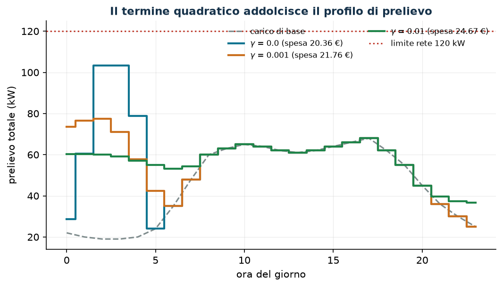
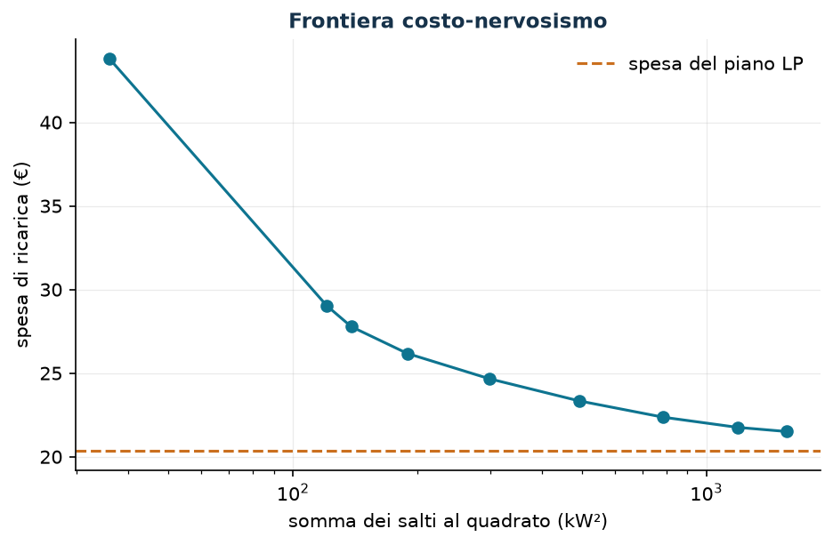

# Ricarica di veicoli elettrici con profilo regolare

[:material-file-pdf-box: Dispensa (PDF)](pdf/dispensa-modellazione-pnl.pdf) · [:material-presentation: Slide del capitolo (PDF)](pdf/slide-10-ricarica-ev-quadratica.pdf) · [:material-pencil: Esercizi](#esercizi)

**Classe:** QP convesso · **Script:** `python/lab10_ricarica_ev_quadratica.py`

[](https://colab.research.google.com/github/fabiofurini/modellazione-pnl/blob/main/notebooks/lab10_ricarica_ev_quadratica.ipynb)

Il caso, i dati e il modello lineare sono quelli di
[Modellazione PL, «Ricarica intelligente di veicoli elettrici»](https://fabiofurini.github.io/modellazione-pl/ricarica-ev/).
La ricarica a costo minimo insegue le ore economiche: il prelievo totale sale fino a
103,4 kW e cambia fino a 54,9 kW da un'ora all'altra. Qui si aggiunge all'obiettivo
una penalità **quadratica** sui salti orari del prelievo totale.

## Modello

**Che cosa cambia.** Dati, variabili e vincoli sono quelli del modello lineare
($x_{vt}$ potenza al veicolo $v$ nell'ora $t$, prezzi $\pi_t$, disponibilità
$a_{vt}$, energia $e_v$, potenze $\bar p_v$, carico di base $b_t$, contatore $k$,
rendimento $\eta$). Si aggiunge un solo dato:

| Simbolo | Tipo | Significato |
|---|---|---|
| $\gamma$ | $\in \mathbb{Q}_{\ge 0}$ | peso dei salti del prelievo totale (€ per kW²) |

Con $z_t = b_t + \sum_{v=1}^{n} x_{vt}$ (un'espressione lineare, non una variabile
nuova), un modello QP per il problema è il seguente:

$$
\begin{aligned}
\min ~~ \sum_{v=1}^{n} \sum_{t=1}^{m} \pi_t\, \Delta t\, x_{vt} + \gamma \sum_{t=2}^{m} \bigl( z_t - z_{t-1} \bigr)^{2} & & \\
\text{soggetto a} \quad \eta \sum_{t=1}^{m} \Delta t\, x_{vt} &\ge e_v, & \forall v \in \{1, 2, \dots, n\}, \\
\sum_{v=1}^{n} x_{vt} + b_t &\le k, & \forall t \in \{1, 2, \dots, m\}, \\
x_{vt} &\le a_{vt}\, \bar p_v, & \forall v \in \{1, 2, \dots, n\},~\forall t \in \{1, 2, \dots, m\}, \\
x_{vt} &\ge 0, & \forall v \in \{1, 2, \dots, n\},~\forall t \in \{1, 2, \dots, m\}.
\end{aligned}
$$

Descrizione della funzione obiettivo e dei vincoli:

- la funzione obiettivo quadratica somma alla spesa energetica il peso $\gamma$ per il
  quadrato di ogni salto orario del prelievo totale;
- i vincoli lineari di **energia** garantiscono il fabbisogno di ogni veicolo
  ($n$ vincoli lineari);
- i vincoli lineari di **rete** limitano il prelievo al contatore ($m$ vincoli lineari);
- i vincoli lineari di **potenza** limitano ogni veicolo e lo azzerano quando è
  assente ($n\,m$ vincoli lineari);
- i vincoli di non negatività definiscono le variabili del modello.

I salti sono quelli del prelievo **totale**, carico di base compreso: la ricarica può
addolcire anche le rampe dell'edificio.

!!! example "Esempio a mano (1 veicolo, 2 ore)"
    $e = 10$ kWh, $\eta = 1$, prezzi $0{,}10$ e $0{,}20$ €/kWh, $\bar p = 12$ kW. Il
    modello lineare carica tutto nell'ora economica. Con $\gamma = 0{,}01$ il solver dà
    $\tilde x = (6{,}25;\ 3{,}75)$, $\tilde z = 1{,}4375$ e moltiplicatore del
    fabbisogno $0{,}15$. Con $x_1 = 5 + d$ l'obiettivo è
    $1{,}5 - 0{,}1d + 4\gamma d^2$, minimo in $d = 1/(80\gamma)$ (per
    $\gamma \ge 1/400$). La stazionarietà dà
    $\lambda = (0{,}10 + 0{,}20)/2 = 0{,}15$: il kWh marginale costa la **media** dei
    due prezzi.

## Risultati

```text
gamma = 0,000: spesa 20,36  picco 103,4 kW  salto max 54,9  somma salti^2 7268,4
gamma = 0,001: spesa 21,76  picco  77,3 kW  salto max 15,4  somma salti^2 1188,4
gamma = 0,010: spesa 24,67  picco  68,0 kW  salto max 10,0  somma salti^2  298,2
```



Con $\gamma = 0{,}01$ il profilo regolare costa 4,31 € a notte in più e porta il
picco a 68 kW, il minimo possibile. Il compromesso lineare costo + ρ·picco di
Modellazione PL arrivava allo stesso picco spendendo meno, perché guarda solo il
massimo; il QP paga anche per addolcire ogni rampa.

## Sensitività

```text
          V1      V2      V3      V4      V5      V6   (EUR/kWh)
g=0     0,0947  0,0842  0,0842  0,0947  0,0947  0,0842
g=0,001 0,0886  0,0886  0,0886  0,0886  0,0886  0,0886
g=0,01  0,0916  0,0916  0,0916  0,0916  0,0916  0,0916
Verifica (g = 0,01): e_1 + 1 kWh -> 0,0917;  e_1 + 0,01 kWh -> 0,0916
```

!!! note "Un solo prezzo per tutti i veicoli"
    Nel modello lineare ogni veicolo ha il suo kWh marginale; nel QP i moltiplicatori
    coincidono, perché la penalità lega i veicoli attraverso il prelievo totale.



!!! tip "Take-away manageriale"
    La frontiera è ripida all'inizio: con 1,15 € in più a notte ($\gamma = 0{,}0005$)
    la somma dei salti al quadrato scende da 7.268 a 1.563. Oltre $\gamma = 0{,}1$ ogni
    ulteriore addolcimento costa molto.

## Codice

Lo script completo del capitolo è
[`python/lab10_ricarica_ev_quadratica.py`](https://github.com/fabiofurini/modellazione-pnl/blob/main/python/lab10_ricarica_ev_quadratica.py)
(riproducibile con `python3 lab10_ricarica_ev_quadratica.py` dalla cartella `python/`); lo
stesso codice è nel notebook che si apre in Colab dal badge in cima alla pagina.

??? example "Mostra lo script completo — `lab10_ricarica_ev_quadratica.py`"

    ```python
    """Capitolo 10 — Ricarica di veicoli elettrici con profilo regolare (QP convesso).

    Caso di studio: lo stesso del modello lineare di ricarica (Modellazione PL):
    deposito aziendale con 6 furgoni elettrici da ricaricare durante la notte,
    prezzi orari dell'energia, carico di base dell'edificio. Qui si aggiunge in
    obiettivo una penalità quadratica sulle variazioni del prelievo totale.

    Contenuto:
      1. Dati (gli stessi del caso lineare)
      2. Esempio svolto a mano: un veicolo, due ore
      3. Il QP sul caso di studio per tre valori di gamma
      4. Moltiplicatori del fabbisogno nel QP e verifica per perturbazione
      5. Sensitività: la frontiera costo-nervosismo al variare di gamma
    """
    import gurobipy as gp
    import numpy as np
    import pandas as pd
    from gurobipy import GRB

    from stile import (ARANCIO, GRIGIO, ROSSO, TEAL, VERDE, intestazione, plt, salva_dat,
                       salva_dati, salva_figura)

    # ----------------------------------------------------------------------
    # 1. DATI (gli stessi del caso lineare)
    # ----------------------------------------------------------------------
    # I dati sono quelli del caso lineare in Modellazione PL: si scrivono qui (stesso seme),
    # così lo script gira anche in Colab; i file CSV stanno nel repository di Modellazione PL.
    ore = list(range(24))                      # ora t = [t, t+1)
    prezzo = np.array([0.09, 0.08, 0.07, 0.07, 0.08, 0.10, 0.14, 0.18, 0.20, 0.19,
                       0.17, 0.16, 0.15, 0.15, 0.16, 0.18, 0.21, 0.24, 0.26, 0.24,
                       0.20, 0.15, 0.12, 0.10])
    base = np.array([22, 20, 19, 19, 20, 24, 35, 48, 60, 63, 65, 64,
                     62, 61, 62, 64, 66, 68, 62, 55, 45, 36, 30, 25], dtype=float)
    veicoli = [f"V{k}" for k in range(1, 7)]
    # (ora arrivo, ora partenza, energia richiesta kWh, potenza max kW)
    flotta = {
        "V1": (18, 7, 46, 11), "V2": (19, 6, 38, 11), "V3": (20, 8, 55, 22),
        "V4": (17, 6, 30, 7.4), "V5": (21, 7, 42, 11), "V6": (22, 8, 50, 22),
    }
    eta = 0.95            # rendimento di carica
    C_rete = 120.0        # potenza massima prelevabile dal contatore (kW)
    disp = {(v, t): 1 if (flotta[v][0] <= t or t < flotta[v][1]) else 0
            for v in veicoli for t in ore}      # finestre a cavallo della mezzanotte


    def costruisci_qp(gamma, energia=None):
        """QP: spesa energetica + gamma * somma dei salti del prelievo totale al quadrato."""
        energia = energia or {v: flotta[v][2] for v in veicoli}
        m = gp.Model("ricarica_ev_qp")
        m.Params.OutputFlag = 0
        x = m.addVars(veicoli, ore, name="x")       # potenza di carica (kW)
        for v in veicoli:
            for t in ore:
                x[v, t].UB = flotta[v][3] * disp[v, t]     # 0 se non collegato
        v_ene = m.addConstrs((eta * gp.quicksum(x[v, t] for t in ore) >= energia[v]
                              for v in veicoli), name="energia")
        m.addConstrs((gp.quicksum(x[v, t] for v in veicoli) + base[t] <= C_rete for t in ore),
                     name="rete")
        z = {t: gp.quicksum(x[v, t] for v in veicoli) + base[t] for t in ore}
        spesa = gp.quicksum(prezzo[t] * x[v, t] for v in veicoli for t in ore)
        salti = gp.quicksum((z[t] - z[t - 1]) * (z[t] - z[t - 1]) for t in ore[1:])
        m.setObjective(spesa + gamma * salti, GRB.MINIMIZE)
        return m, x, v_ene


    def leggi(x):
        carica = np.array([sum(x[v, t].X for v in veicoli) for t in ore])
        z = carica + base
        salti = np.diff(z)
        spesa = float(prezzo @ carica)
        return spesa, z, salti, float((salti ** 2).sum())


    # ----------------------------------------------------------------------
    # 2. ESEMPIO SVOLTO A MANO: UN VEICOLO, DUE ORE
    # ----------------------------------------------------------------------
    intestazione("Esempio a mano: un veicolo, due ore (e = 10, prezzi 0,10 e 0,20, p_max = 12)")
    for g in (0.0, 0.01, 0.1):
        me = gp.Model("esempio")
        me.Params.OutputFlag = 0
        x1 = me.addVar(ub=12, name="x1")
        x2 = me.addVar(ub=12, name="x2")
        ce = me.addConstr(x1 + x2 >= 10, name="energia")
        me.setObjective(0.10 * x1 + 0.20 * x2 + g * (x2 - x1) * (x2 - x1), GRB.MINIMIZE)
        me.optimize()
        print(f"  gamma = {g:4.2f}: x1 = {x1.X:6.3f}  x2 = {x2.X:6.3f}  spesa = "
              f"{0.10 * x1.X + 0.20 * x2.X:6.4f}  obiettivo = {me.ObjVal:6.4f}  Pi = {ce.Pi:.4f}")
    print(f"  formula: x1 = 5 + 1/(80 gamma); con gamma = 0,01: x1 = {5 + 1 / (80 * 0.01):.2f}")

    # ----------------------------------------------------------------------
    # 3. IL QP SUL CASO DI STUDIO
    # ----------------------------------------------------------------------
    intestazione("QP sul caso di studio: tre valori di gamma")
    GAMMA = [0.0, 0.001, 0.01]
    ris = {}
    for g in GAMMA:
        m, x, v_ene = costruisci_qp(g)
        m.optimize()
        assert m.Status == GRB.OPTIMAL
        spesa, z, salti, sq = leggi(x)
        ris[g] = dict(obj=m.ObjVal, spesa=spesa, z=z, salti=salti, sq=sq,
                      pi={v: v_ene[v].Pi for v in veicoli})
        print(f"gamma = {g:5.3f}: obiettivo {m.ObjVal:7.2f} €  spesa {spesa:6.2f} €  "
              f"picco {z.max():6.1f} kW  salto massimo {np.abs(salti).max():5.1f} kW  "
              f"somma salti^2 {sq:8.1f}")
    print(f"\nCosto della regolarità (gamma = 0,01): "
          f"{ris[0.01]['spesa'] - ris[0.0]['spesa']:.2f} € a notte")

    # ----------------------------------------------------------------------
    # 4. MOLTIPLICATORI DEL FABBISOGNO NEL QP
    # ----------------------------------------------------------------------
    intestazione("Moltiplicatori del fabbisogno (€/kWh)")
    for v in veicoli:
        print(f"  {v}: gamma=0 {ris[0.0]['pi'][v]:.4f}   gamma=0,001 {ris[0.001]['pi'][v]:.4f}   "
              f"gamma=0,01 {ris[0.01]['pi'][v]:.4f}")
    base_obj = ris[0.01]["obj"]
    for eps in (1.0, 0.01):
        en = {v: flotta[v][2] for v in veicoli}
        en["V1"] += eps
        m2, _, _ = costruisci_qp(0.01, en)
        m2.optimize()
        print(f"Verifica (gamma = 0,01): e_1 + {eps:g} kWh -> obiettivo da {base_obj:.4f} a "
              f"{m2.ObjVal:.4f} (rapporto incrementale {(m2.ObjVal - base_obj) / eps:.4f}; "
              f"Pi = {ris[0.01]['pi']['V1']:.4f})")

    # ----------------------------------------------------------------------
    # 5. SENSITIVITÀ: FRONTIERA COSTO-NERVOSISMO
    # ----------------------------------------------------------------------
    intestazione("Frontiera costo-nervosismo al variare di gamma")
    griglia = [0.0, 0.0005, 0.001, 0.002, 0.005, 0.01, 0.02, 0.05, 0.1, 0.5]
    front = []
    for g in griglia:
        m, x, _ = costruisci_qp(g)
        m.optimize()
        spesa, z, salti, sq = leggi(x)
        front.append((g, spesa, sq, float(np.abs(salti).max()), float(z.max())))
        print(f"  gamma = {g:6.4f}: spesa {spesa:6.2f} €  somma salti^2 {sq:8.1f}  "
              f"salto max {np.abs(salti).max():5.1f} kW  picco {z.max():6.1f} kW")
    front = pd.DataFrame(front, columns=["gamma", "spesa", "salti_quadrati", "salto_max", "picco"])
    salva_dati(front, "ev_frontiera_regolarita")

    # ----------------------------------------------------------------------
    # 6. FIGURE (dati pgfplots + anteprima matplotlib)
    # ----------------------------------------------------------------------
    salva_dat(pd.DataFrame({"ora": ore, "prezzo_cent": prezzo * 100, "base": base,
                            "gzero": ris[0.0]["z"], "gpiccolo": ris[0.001]["z"],
                            "ggrande": ris[0.01]["z"]}), "cap10_profili_qp")
    salva_dat(front[front["gamma"] > 0], "cap10_frontiera_qp")

    fig, ax = plt.subplots(figsize=(8.2, 4.2))
    ax.plot(ore, base, color=GRIGIO, ls="--", label="carico di base")
    for g, c in zip(GAMMA, [TEAL, ARANCIO, VERDE]):
        ax.plot(ore, ris[g]["z"], color=c, lw=2, drawstyle="steps-mid",
                label=f"$\\gamma$ = {g} (spesa {ris[g]['spesa']:.2f} €)")
    ax.axhline(C_rete, color=ROSSO, ls=":", label=f"limite rete {C_rete:.0f} kW")
    ax.set_xlabel("ora del giorno"); ax.set_ylabel("prelievo totale (kW)")
    ax.set_title("Il termine quadratico addolcisce il profilo di prelievo")
    ax.legend(fontsize=8, ncol=2)
    salva_figura(fig, "cap10_profili_qp")

    f2 = front[front["gamma"] > 0]
    fig, ax = plt.subplots()
    ax.plot(f2["salti_quadrati"], f2["spesa"], "-o", color=TEAL)
    ax.axhline(ris[0.0]["spesa"], color=ARANCIO, ls="--", label="spesa del piano LP")
    ax.set_xscale("log")
    ax.set_xlabel("somma dei salti al quadrato (kW²)")
    ax.set_ylabel("spesa di ricarica (€)")
    ax.set_title("Frontiera costo-nervosismo")
    ax.legend()
    salva_figura(fig, "cap10_frontiera_qp")

    print("\nFatto: capitolo 10.")
    ```

## Esercizi

1. **A mano** — nell'esempio porre $\gamma = 0{,}05$: calcolare $x_1$, $x_2$, spesa,
   valore ottimo e moltiplicatore.
2. **Verifica** — con $\gamma = 0{,}001$ verificare per perturbazione il moltiplicatore
   del fabbisogno di V3.
3. **Solo la ricarica** — penalizzare i salti di $\sum_v x_{vt}$ invece di $z_t$, con
   $\gamma = 0{,}01$.
4. **Penalità sulla potenza** — sostituire la penalità con $\gamma \sum_t z_t^2$,
   $\gamma = 0{,}001$: che forma prende il prelievo notturno?
5. **Contatore** — con $\gamma = 0{,}001$ ridurre il contatore a $k = 70$ kW.
